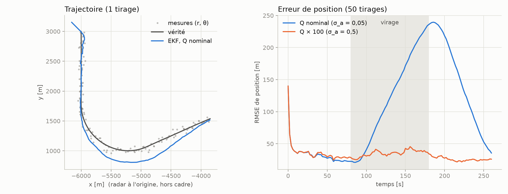
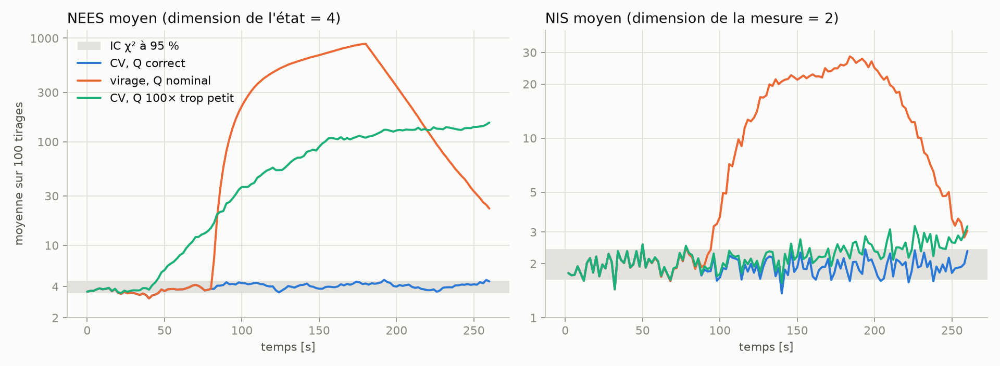
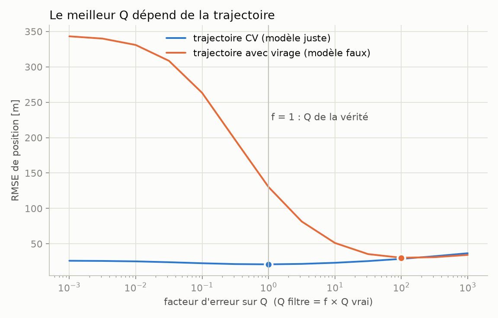

# Pistage radar maritime : quelles briques d'un filtre de Kalman l'IA peut-elle améliorer ?

> **Projet en cours.**
> C'est un support d'apprentissage (radar, filtrage de Kalman, pistage), pas un produit :
> le code est écrit pour être lu et compris, et n'a aucune prétention opérationnelle.

## Objectif

Construire pas à pas une chaîne de pistage radar maritime, avec tout le filtrage codé à la main
(sans bibliothèque de filtrage dans `src/`), puis mesurer honnêtement ce qu'une brique d'IA
apporte, ou non, par rapport à un EKF et à un IMM.

## État d'avancement

| Jalon | Contenu | État |
|---|---|---|
| S0 | Bases radar + Kalman | en cours |
| A | Kalman / EKF, une cible | terminé |
| B | Chaîne signal : chirp → distance-Doppler → CFAR | en cours |
| C | Multi-cibles : GNN + clutter + IMM + OSPA | à faire |
| D | Une expérience IA (gain appris ou R adaptatif) | à faire |

Les résultats et figures seront ajoutés ici (figures dans `figures/`) à la fin de chaque jalon.

## Jalon A — Kalman / EKF, une cible

KF linéaire et EKF à mesures polaires (r, θ) codés à la main (`src/tracking/kf.py`, `ekf.py`),
trajectoires CV / virage (`src/sim/trajectories.py`), NEES / NIS (`src/metrics/nees.py`).
Notebook : [notebooks/A_ekf.ipynb](notebooks/A_ekf.ipynb).

**Validations (tests dans `tests/`)**

| Vérification | Résultat |
|---|---|
| KF vs `filterpy.kalman.KalmanFilter` (x, P, innovation, S) | identiques à 1e-9 |
| RMSE du filtre vs RMSE des mesures (CV, Q et R corrects) | 13 m contre 42 m |
| Jacobienne analytique de h vs différences finies | accord à 1e-6 (rel.) |
| Cible traversant θ = ±π | innovation max 0,03 rad avec normalisation (6,28 rad sans) |
| NEES moyen, 100 Monte-Carlo, CV, Q correct (EKF et KF) | 3,96 pour 4 attendu, IC χ² 95 % : [3,46 ; 4,57] |
| NIS moyen, même scénario | 1,95 pour 2 attendu, IC : [1,63 ; 2,41] |

**Figure 1 — l'EKF décroche en virage avec un modèle CV.** Un Q 100 fois plus grand l'en empêche, mais bruite la ligne droite.



**Figure 2 — cohérence.** Dans la bande χ² quand le modèle est juste ; NEES ≈ 260 en virage ; un Q trop petit se voit à peine dans le NIS.



**Figure 3 — Q faux.** Q correct : 21 m en ligne droite mais 130 m en virage ; Q × 100 : 30 m en virage mais 29 m en ligne droite. Un Q fixe est un compromis, ce qui motive l'IMM (jalon C) et les approches apprises (jalon D).



## Structure

```
src/
├── radar/      # forme d'onde, simulation, traitement (CFAR, Keystone)
├── sim/        # trajectoires, scénarios multi-cibles
├── tracking/   # kf, ekf, imm, gnn, gestion de pistes
├── learned/    # kalmannet, R adaptatif
└── metrics/    # rmse, ospa, nees
notebooks/      # un notebook par jalon
tests/          # validations théoriques (pytest)
cpp/            # jalon G (optionnel)
figures/        # figures générées pour ce README
```

## Installation

Python 3.11 et [uv](https://docs.astral.sh/uv/) :

```bash
uv sync
uv run pytest
```

## Règles du projet

- `filterpy` n'est utilisé que dans `tests/`, comme référence de comparaison.
- Chaque validation théorique (pic au bon endroit, NEES, jacobienne, ...) est un test `pytest`.
- Graines aléatoires fixées, paramètres dans des dataclasses.
