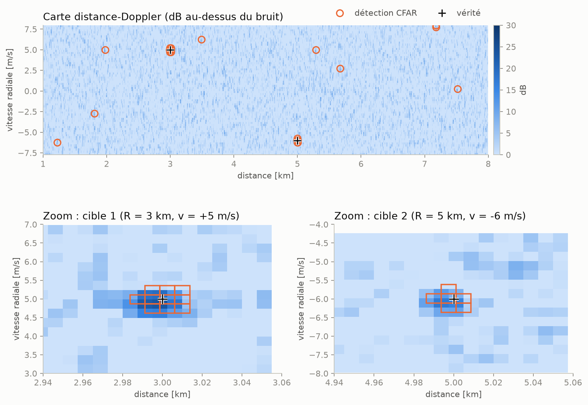
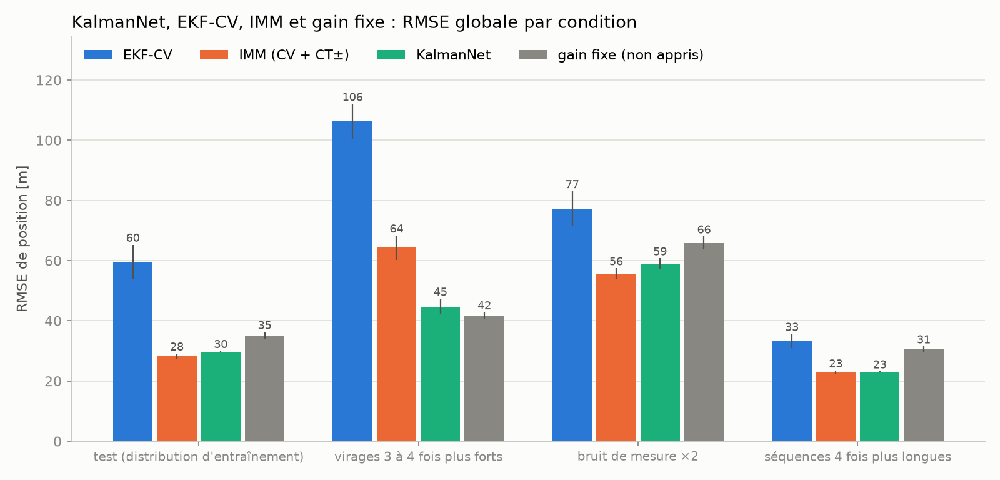

# Pistage radar maritime : quelles briques d'un filtre de Kalman l'IA peut-elle améliorer ?

> **Projet en cours.**

## Objectif

Construire pas à pas une chaîne de pistage radar maritime, avec tout le filtrage codé à la main (sans bibliothèque de filtrage dans `src/`), puis mesurer ce qu'une brique d'IA apporte, ou non, par rapport à un EKF et à un IMM.

## Résultats

Chaque jalon est détaillé dans [experiments/](experiments/) (montage, validations, tableaux, toutes les figures, commandes pour reproduire).

### A — Kalman / EKF, une cible · [détails](experiments/A_kalman_ekf.md)

- KF et EKF polaire codés à la main ; le KF est identique à `filterpy` à 1e-9 et l'EKF est **honnête** : NEES moyen 3,96 pour 4 attendu (IC χ² 95 % : 3,46 à 4,57).
- Avec un modèle CV dans un virage, l'EKF décroche : 130 m d'erreur contre 21 m en ligne droite, NEES ≈ 260.
- Un Q fixe est un compromis : Q × 100 ramène le virage à 30 m mais coûte 37 % en ligne droite. C'est la motivation de l'IMM et des approches apprises.


### B — Chaîne signal : chirp → distance-Doppler → CFAR · [détails](experiments/B_chaine_signal.md)

- Chaque étage est validé contre la théorie : largeur du pic 0,884/B (théorie 0,886/B), gain de compression 199,8 (T·fs = 200, et non B·T car fs = 2B), gain Doppler 41,5 (Hann).
- CA-CFAR : Pfa mesurée 1,35 à 1,67 fois la visée, à cause des cellules voisines corrélées (fs = 2B, Hann) : avec des cases indépendantes, elle retombe à 1,02 fois la visée ; courbe Pd(SNR) à 0,6–0,8 dB de la théorie.



### C — Multi-cibles : GNN + clutter + IMM + OSPA · [détails](experiments/C_multi_cibles_imm.md)

- Pisteur complet (gating de Mahalanobis, association hongroise, confirmation M/N) sur 10 navires, Pd = 0,9, ~10 fausses alarmes par balayage ; 50 Monte-Carlo.
- L'IMM à 3 modèles (CV, CT+, CT−) divise l'erreur en virage par ≈ 1,9 (32,9 m contre 61,7 m), l'OSPA passe de 57,7 à 38,8 m et les changements d'identité de 11,1 à 1,3 par scénario.
- L'IMM à 2 modèles ne gagne que dans le sens de virage de son CT ; en ligne droite l'IMM perd ≈ 6 % ; son temps par mise à jour est ×3 à ×4.


### D — Gain de Kalman appris (KalmanNet) · [détails](experiments/D_kalmannet.md)

- Un GRU de 19 592 paramètres remplace le calcul du gain d'un filtre CV (gain borné autour d'un a priori alpha-bêta), 3 graines d'entraînement, 300 trajectoires de test par condition.
- **Résultat négatif** : KalmanNet ne bat pas l'IMM en virage (43,6 m contre 33,5 m). L'apprentissage ne paie qu'en ligne droite (27,5 m, au niveau de l'IMM, contre 34,3 m pour le même gain non appris) : avec 12 % des pas en virage, la perte pousse le réseau à lisser.
- Hors distribution, sur des virages 3 à 4 fois plus forts, il bat largement l'IMM (44,7 contre 64,3 m, modèles CT désaccordés), mais un gain fixe non appris fait mieux (41,7 m). Coût par mise à jour : ×1,3 l'IMM, ×11 l'EKF.



## Structure

```
src/
├── radar/      # forme d'onde, simulation, traitement (CFAR, Keystone)
├── sim/        # trajectoires, scénarios multi-cibles
├── tracking/   # kf, ekf, imm, gnn, gestion de pistes
├── learned/    # kalmannet, R adaptatif
└── metrics/    # rmse, ospa, nees
notebooks/      # un notebook par jalon
experiments/    # détails de chaque jalon (montage, validations, tableaux, figures), un .md par jalon
tests/          # validations théoriques (pytest)
cpp/            # jalon G (optionnel)
figures/        # figures générées par les notebooks
```

## Installation

Python 3.11 et [uv](https://docs.astral.sh/uv/) :

```bash
uv sync
uv run pytest
```

## Règles du projet

- `filterpy` n'est utilisé que dans `tests/`, comme référence de comparaison.
- Chaque validation théorique (pic au bon endroit, NEES, jacobienne, ...) est un test `pytest`.
- Graines aléatoires fixées, paramètres dans des dataclasses.
