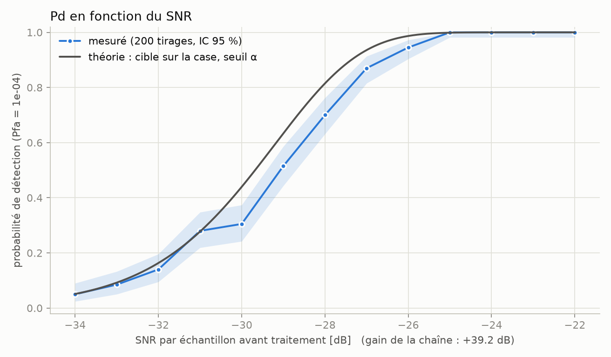

# Jalon B — Chaîne signal : chirp → distance-Doppler → CFAR

[← README](../README.md) · Notebook : [B_range_doppler.ipynb](../notebooks/B_range_doppler.ipynb)

## Objectif

Simuler un radar impulsionnel en bande de base, le traiter (compression d'impulsion, FFT Doppler, CA-CFAR 2D) et valider
chaque étage contre la théorie avant tout usage.

## Montage

Un radar en simulation est un tableau complexe `(N impulsions, n échantillons)` : temps rapide (distance) × temps lent (vitesse).
L'écho d'une cible est le chirp retardé de τ = 2R/c (évalué analytiquement, donc retards fractionnaires exacts), déphasé de
exp(−j2π·fc·τ), plus du bruit complexe gaussien.

- Bande X (λ = 3,19 cm), B = 10 MHz, T = 10 µs, PRF = 1 kHz, N = 64 impulsions, fs = 2B (pas distance 7,5 m, ΔR = 15 m).
- Convention de signe : v > 0 = la cible s'éloigne, ce qui donne une fréquence Doppler **négative** (−2v/λ).
- CA-CFAR 2D : garde (2, 2), référence (2, 6), soit 128 cellules de référence ; axe Doppler circulaire, axe distance borné.
- Code : `src/radar/waveform.py`, `simulate.py`, `processing.py`.

## Validations (tests dans `tests/`)

| Vérification | Théorie | Mesuré |
|---|---|---|
| Largeur à −3 dB de l'autocorrélation du chirp | 0,886 / B | 0,884 / B (10 MHz), 0,885 / B (20 MHz) |
| Position du pic (cible à 3 km, 5 m/s) | case distance et Doppler attendues | distance à 2,5 m (pas de 7,5 m), vitesse à 0,02 m/s |
| Gain de compression d'impulsion | T·fs = 200 (23 dB) | 199,8 |
| Gain Doppler, fenêtre de Hann | (Σw)² / Σw² ≈ 42 | 41,5 (−1,3 %) |
| Pfa du CA-CFAR sur bruit seul | visée 10⁻³ / 10⁻⁴ | 1,35 × / 1,57 × la visée (critère : facteur 2) |
| Courbe Pd(SNR), Pfa = 10⁻⁴, 200 tirages | seuil de Pd = 0,5 à −29,7 dB | −29,1 dB (+0,6 dB) ; Pd = 0,9 : +0,8 dB |

Le gain de compression vaut **T·fs** et non B·T (tableau du ROADMAP), parce que fs = 2B. La Pfa du CFAR est au-dessus de la visée :
explication la plus probable (non isolée par une expérience dédiée), les cases voisines sont corrélées (suréchantillonnage fs = 2B,
fenêtre de Hann), donc le bruit de référence est moins bien moyenné que si les cellules étaient indépendantes.

## Figure 4 — carte distance-Doppler (dB) et détections CA-CFAR

Deux cibles invisibles dans le signal brut (−15 dB par échantillon) ressortent à 24 et 17 dB. SNR de sortie mesuré / prédit :
23,8 / 24,2 dB (cible 1) et 17,1 / 18,2 dB (cible 2), l'écart venant de la perte entre deux cases. Les cercles isolés sont des
fausses alarmes attendues (Pfa = 10⁻⁴ sur 256 000 cases).


## Figure 5 — Pd en fonction du SNR

200 tirages par SNR, cible à position et vitesse aléatoires (perte de straddle incluse), Pfa = 10⁻⁴, IC de Clopper-Pearson à 95 %.
La courbe théorique (cible sur la case, seuil α du CA-CFAR) est un peu à gauche de la courbe mesurée. Pfa mesurée sur ces tirages :
1,67 × la visée. L'écart de 0,6 à 0,8 dB n'est pas décomposé entre perte de straddle, fluctuation de l'estimation du bruit par le CFAR
et corrélation des cellules.



## Ce qu'on retient

- Le pic tombe dans la bonne case distance et Doppler, et la vitesse lue porte le signe imposé par la phase.
- Compression (+23 dB) et intégration Doppler (+16 dB avec Hann) : une cible à −15 dB par échantillon sort à ≈ 24 dB.
- Le CA-CFAR tient sa Pfa à un facteur < 2 près, au-dessus de la valeur visée.

## Reproduire

```bash
uv run pytest tests/test_waveform.py tests/test_simulate.py tests/test_processing.py
uv run jupyter nbconvert --to notebook --execute --inplace notebooks/B_range_doppler.ipynb   # ~2 min
```
