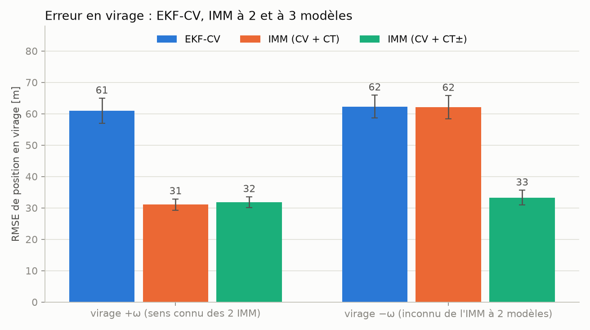
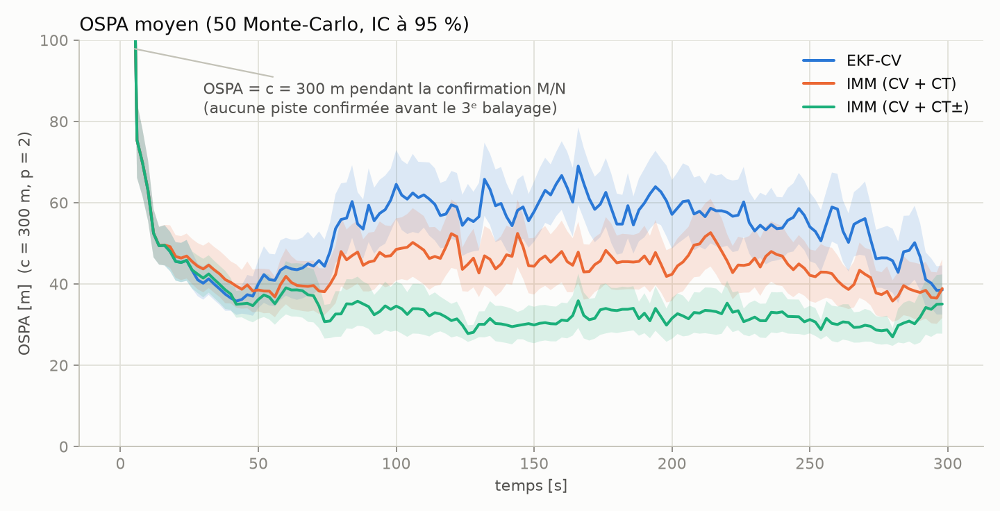
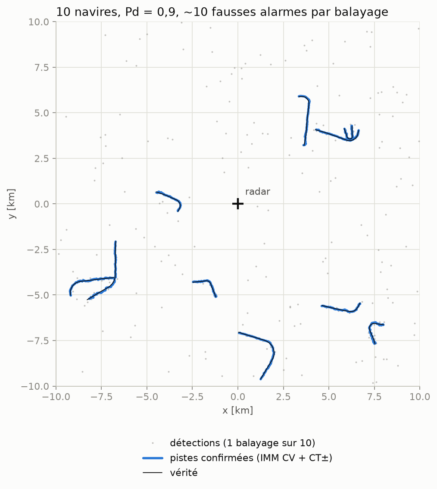

# Jalon C — Multi-cibles maritime : GNN + clutter + IMM + OSPA

[← README](../README.md) · Notebook : [C_multitarget.ipynb](../notebooks/C_multitarget.ipynb)

## Objectif

Pister plusieurs navires dans des fausses alarmes, comparer un EKF à modèle CV seul à des IMM (CV + CT), et mesurer l'écart avec
des métriques de pistage (OSPA, RMSE, pertes de piste, changements d'identité, fausses pistes, temps par mise à jour).

## Montage

Le pistage travaille sur des détections `(r, θ)`, pas sur le signal : on simule directement les détections.

- **Scénario** (`src/sim/scenario.py`) : 10 navires (CV / virages de taux ±0,015 à ±0,03 rad/s) dans une zone de 20 km × 20 km,
  Pd = 0,9, fausses alarmes de Poisson (λ ≈ 10 par balayage) uniformes, 150 balayages de 2 s. Sérialisable et rejouable à l'identique.
- **Association** (`gnn.py`) : porte de Mahalanobis (χ² à 99,9 %) puis affectation hongroise (`scipy.optimize.linear_sum_assignment`).
- **Gestion de pistes** (`track_manager.py`) : confirmation M/N = 3 sur 4, suppression après 5 balayages consécutifs sans détection.
- **IMM** (`imm.py`) : CV + CT, probabilité de rester dans un modèle 0,98, taux de virage des CT = ±0,02 rad/s (fixe, alors que les
  navires tournent à 0,015–0,03 rad/s).
- **Métriques** (`src/metrics/ospa.py`, `rmse.py`) : OSPA avec c = 300 m (≈ taille de la porte d'association : au-delà, une piste
  compte comme une cible manquée plus une fausse piste) et p = 2 (pénalise les grosses erreurs comme un RMSE).

Trois pisteurs, mêmes règles de gestion, seul le filtre de chaque piste change :
**EKF-CV**, **IMM (CV + CT)** à 2 modèles (virage +ω seulement) et **IMM (CV + CT±)** à 3 modèles (virages dans les deux sens).

## Validations (tests dans `tests/`)

| Vérification | Résultat |
|---|---|
| IMM vs `filterpy.kalman.IMMEstimator` (x, P, probabilités de modèle, 1 cible) | identiques à 1e-8 |
| Association hongroise vs force brute (200 petits problèmes) | optimum identique |
| OSPA : deux ensembles identiques / un vide contre un non vide | 0 / c (exactement) |
| Pd empirique des scénarios, fausses alarmes par balayage | 0,9 ± 0,02 ; moyenne = variance = λ (Poisson) |
| Une cible, virage, 40 tirages : erreur de l'IMM à 3 modèles / de l'EKF-CV | < 0,5 (mesuré ≈ 0,15) |
| NEES moyen en virage, IMM / EKF-CV | 4,0 (dans l'IC χ²) / ≈ 520 |

## Résultats — scénario « manœuvres » (tous les navires virent)

50 Monte-Carlo, moyenne ± IC de Student à 95 %.

| pisteur | OSPA moyen [m] | RMSE [m] | RMSE en virage [m] | pertes de piste | changements d'identité | fausses pistes |
|---|---|---|---|---|---|---|
| EKF-CV | 57.7 ± 1.8 | 45.3 ± 1.7 | 61.7 ± 2.4 | 0.30 ± 0.14 | 11.1 ± 0.7 | 0.56 ± 0.19 |
| IMM (CV + CT) | 49.0 ± 2.0 | 38.8 ± 1.7 | 48.1 ± 2.5 | 0.14 ± 0.10 | 5.6 ± 0.7 | 0.62 ± 0.19 |
| IMM (CV + CT±) | 38.8 ± 1.5 | 31.4 ± 0.9 | 32.9 ± 1.4 | 0.06 ± 0.07 | 1.3 ± 0.6 | 0.50 ± 0.18 |

Le nombre de fausses pistes (≈ 0,5 par scénario) est le même pour les trois pisteurs : il dépend du gating et de la règle M/N, pas du filtre.

## Résultats — témoin « ligne droite » (aucun virage)

| pisteur | OSPA moyen [m] | RMSE [m] | changements d'identité |
|---|---|---|---|
| EKF-CV | 33.8 ± 1.5 | 27.7 ± 0.7 | 0.4 ± 0.2 |
| IMM (CV + CT) | 36.3 ± 1.8 | 29.4 ± 0.7 | 0.7 ± 0.4 |
| IMM (CV + CT±) | 36.2 ± 1.6 | 29.3 ± 0.7 | 0.7 ± 0.3 |

En ligne droite l'IMM est légèrement moins bon (RMSE ≈ +6 %, intervalles disjoints) : les modèles CT injectent un peu de bruit
quand il n'y a pas de virage.

## Erreur en virage selon le sens du virage

RMSE de position pendant les virages [m] :

| pisteur | virage +ω | virage −ω |
|---|---|---|
| EKF-CV | 60,9 | 62,3 |
| IMM (CV + CT) | 31,0 | 62,1 |
| IMM (CV + CT±) | 31,8 | 33,3 |

Un modèle CT a un taux de virage **signé** : l'IMM à 2 modèles divise l'erreur par ≈ 2 dans le sens de son CT et n'apporte rien
dans l'autre. Il faut un CT par sens pour gagner partout. Ce n'est pas un bug : constaté d'abord en mono-cible (21,6 m contre 141 m
dans le bon sens, 101 m dans l'autre), puis en multi-cibles.



## OSPA au cours du temps

Moyenne sur 50 tirages et IC à 95 % (bande). Au début, l'OSPA vaut c = 300 m le temps de la confirmation M/N (3 balayages) ;
ensuite l'écart entre pisteurs se creuse avec les virages.



## Un scénario et les pistes de l'IMM



## Coût

Temps par mise à jour (balayage entier rapporté au nombre de pistes traitées), médiane [min – max] sur 8 scénarios, un seul processus :

| pisteur | temps par mise à jour [µs] | rapport à l'EKF-CV |
|---|---|---|
| EKF-CV | 455 [431 – 490] | 1,0 × |
| IMM (CV + CT) | 1 304 [1 292 – 1 344] | 2,9 × |
| IMM (CV + CT±) | 1 708 [1 678 – 1 763] | 3,8 × |

## Ce qu'on retient

- L'IMM à 3 modèles réduit l'erreur en virage d'un facteur ≈ 1,9 dans les deux sens et supprime presque tous les changements
  d'identité (1,3 contre 11,1 par scénario), pour un coût de calcul ×3,8.
- Il perd ≈ 6 % en ligne droite.
- Le taux de virage des modèles CT est fixe ; l'estimer dans l'état (EKF à 5 états) est la suite naturelle, hors périmètre ici.

## Reproduire

```bash
uv run pytest tests/test_scenario.py tests/test_gnn.py tests/test_track_manager.py tests/test_imm.py tests/test_ospa.py
uv run jupyter nbconvert --to notebook --execute --inplace notebooks/C_multitarget.ipynb   # ~10 min (6 processus)
```
